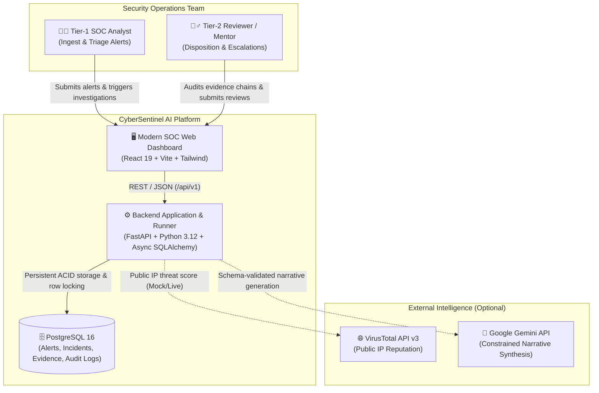
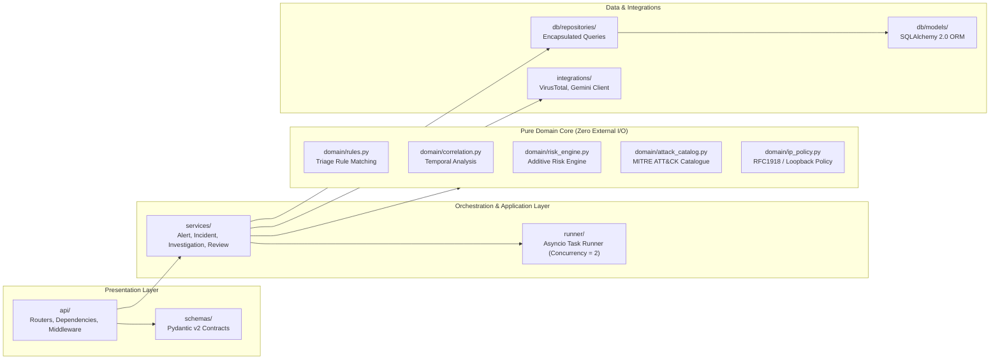

# 🛡️ CyberSentinel AI

<div align="center">

[](https://python.org)
[](https://fastapi.tiangolo.com)
[](https://www.postgresql.org)
[](https://react.dev)
[](https://www.typescriptlang.org)
[](https://tailwindcss.com)
[](https://www.docker.com)
[](https://opensource.org/licenses/MIT)

**Evidence-Grounded SOC Alert Triage and Multi-Agent Automated Investigation System**

*Deterministic threat triage • Cryptographically verified evidence chains • MITRE ATT&CK mapping • Human-in-the-Loop disposition review*

[Quick Start](#-quick-start) • [Architecture](#-system-architecture) • [Agent Structure & Flow](#-agent-structure--pipeline-flow) • [Risk Engine](#-deterministic-risk-engine-risk-v1) • [API Reference](#-api-endpoints)

---

</div>

## 📌 Executive Overview

**CyberSentinel AI** is an enterprise-grade Security Operations Center (SOC) triage and investigation platform engineered to solve alert fatigue and hallucinated automated responses. Designed as an **evidence-first** investigation pipeline, every conclusion, risk calculation, and ATT&CK mapping directly references an append-only, SHA-256 checksummed evidence artifact (`EV-NNN`).

### Core Design Invariants

- 🔒 **Evidence Before Claim**: Findings and risk assessments cite immutable evidence rows. Claims without cited evidence are rejected.
- 📐 **Deterministic Risk Engine (`risk-v1`)**: Scoring (0–100) is computed mathematically via rules `R-01` through `R-06`. GenAI never invents risk scores.
- 🎯 **MITRE ATT&CK Alignment**: Vendor-neutral candidate mapping to curated enterprise techniques (e.g., `T1110`, `T1078`, `T1133`) with official MITRE references.
- 🛡️ **Read-Only by Construction**: Recommends disposition only; contains no destructive host isolation or network containment tools. The worst failure mode is an invalid draft report subject to human review.
- 👤 **Human-in-the-Loop (HITL)**: Empowers Tier-1/Tier-2 analysts with structured review dispositions (`Accept`, `Reject / False Positive`, `Escalate`).

---

## 🏛️ System Architecture

CyberSentinel AI operates as a **modular monolith** optimized for strict auditability and transparency. Deterministic domain functions execute all security logic, while LLMs (e.g., Google Gemini) are strictly isolated to narrative synthesis and report authoring.

### C4 Level 1 — System Context



### Component Architecture & Dependency Boundaries



> [!NOTE]
> **Strict Layering Invariant**: The `domain/` package contains zero I/O, no database imports, no network clients, and no framework dependencies. It is pure, deterministic Python verified via AST isolation tests.

---

## 🤖 Agent Structure & Pipeline Flow

The investigation lifecycle executes an automated multi-step agent pipeline. Every stage enriches the state and emits cryptographically signed evidence records before advancing.

### Investigation Execution Flow

```mermaid
sequenceDiagram
    autonumber
    actor Analyst as 👨‍💻 SOC Analyst
    participant UI as 🖥️ React Dashboard
    participant API as ⚡ FastAPI Endpoint
    participant Svc as 🧩 InvestigationService
    participant DB as 🗄️ PostgreSQL 16
    participant Intel as 🌐 Threat Intel (VT)
    participant LLM as 🤖 Narrative Agent (Gemini)

    Analyst->>UI: Click "Launch Investigation"
    UI->>API: POST /api/v1/alerts/{id}/investigate
    API->>Svc: start_investigation(alert_id)
    Svc->>DB: Check for active investigation run
    alt Active run exists
        Svc-->>API: ConflictError (409)
        API-->>UI: 409 Investigation In Progress
    else Run eligible
        Svc->>DB: Create Investigation (status: RUNNING)
        Svc-->>API: 202 Accepted {investigation_id, poll_url}
        API-->>UI: 202 Accepted (Begins 1s polling)
    end

    rect rgb(20, 30, 45)
        note over Svc,DB: Step 1: Base Evidence Capture
        Svc->>DB: Insert EV-001 (Anchor Event Snapshot, SHA-256)
    end

    rect rgb(25, 35, 55)
        note over Svc,DB: Step 2: Deterministic Triage Agent
        Svc->>Svc: Evaluate rules (Authentication bursts, privilege, anomalies)
        Svc->>DB: Record rule findings & evidence references
    end

    rect rgb(30, 40, 60)
        note over Svc,DB: Step 3: Correlation Agent
        Svc->>DB: Query events within 30-min window (Limit: 200)
        Svc->>Svc: Correlate user, IP, and host pivot patterns
    end

    rect rgb(35, 45, 65)
        note over Svc,Intel: Step 4: Threat Intelligence Agent
        Svc->>Svc: Classify IP (RFC1918 / Loopback filter)
        opt Public IP & Enrichment != off
            Svc->>Intel: Query VirusTotal v3 reputation
            Intel-->>Svc: Reputation score / malicious engine count
        end
        Svc->>DB: Insert threat intelligence evidence row
    end

    rect rgb(40, 50, 70)
        note over Svc,DB: Step 5: MITRE ATT&CK Mapping Agent
        Svc->>Svc: Map findings to curated ATT&CK techniques (T1110, T1078, etc.)
    end

    rect rgb(45, 55, 75)
        note over Svc,DB: Step 6: Additive Risk Scoring Engine
        Svc->>Svc: Compute risk-v1 additive score (0-100) & confidence rating
        Svc->>DB: Update Incident (score, severity, band, status: awaiting_review)
    end

    rect rgb(50, 60, 80)
        note over Svc,LLM: Step 7: Narrative Synthesis & Validation
        opt LLM Enabled (GEMINI)
            Svc->>LLM: Request structured findings summary citing EV-NNN
            LLM-->>Svc: Structured narrative response
            Svc->>Svc: Validate Pydantic schema & citations (Auto-repair if invalid)
        end
        Svc->>DB: Store immutable Report (schema: report-v1)
        Svc->>DB: Complete Investigation (status: COMPLETED)
        Svc->>DB: Insert Audit Log entry
    end

    UI->>API: GET /api/v1/investigations/{id}
    API-->>UI: Investigation Complete (Status: COMPLETED, Trace & Report)
    UI-->>Analyst: Render Evidence Inspector & Risk Breakdown
```



### Specialized Agents & Node Roles

| Agent / Stage | Responsibility | Primary Inputs | Output & Evidence Produced | Fallback / Degradation |
|---|---|---|---|---|
| **Anchor Capture** | Extracts alert snapshot and computes immutable checksum | Raw SOC Alert payload | `EV-001` Anchor Evidence with SHA-256 | Fatal if alert payload unparseable |
| **Triage Agent** | Evaluates baseline rule indicators (failure counts, critical targets) | Anchor event + metadata | Triage findings with evidence references | Deterministic rules; zero hallucination |
| **Correlation Agent** | Discovers temporal cluster patterns across configurable window (30m) | Host, username, source IP, time window | Linked event clusters & pivot counts | Empty correlation set on timeout |
| **Threat Intel Agent** | Evaluates IP eligibility (RFC1918 filter) & queries reputation engines | Source IP address | Reputation scores, malicious verdicts | Safe gap notation (`ip_not_eligible`) |
| **ATT&CK Mapping Agent** | Attaches vendor-neutral MITRE techniques with canonical documentation links | Triage findings + correlated events | `attack_candidates[]` (e.g., T1110 Brute Force) | Empty candidate list without breaking pipeline |
| **Risk Scoring Engine** | Mathematical evaluation of model `risk-v1` across rules R-01 to R-06 | Fired rules, assets, reputation, context | Additive score (0–100), Risk Band & Confidence | Failsafe degradation score with flagged gaps |
| **Narrative Agent** | Synthesizes coherent analyst executive summary citing evidence keys | Full investigation state & facts | Structured investigation report | Fallback to deterministic template |
| **Validation Agent** | Cross-validates generated report citations against persisted evidence | Output report + evidence repository | Validated final report or triggers 1x repair | Deterministic report fallback on format failure |

---

## 📊 Deterministic Risk Engine (`risk-v1`)

The scoring model is completely deterministic and verifiable. No LLM controls or modifies the numerical score.

$$Score = \min\left(\sum \text{Fired Rule Points}, 100\right)$$

### Rule Catalogue

| Rule ID | Name | Conditions / Thresholds | Points | Evidence Reference |
|---|---|---|---|---|
| **R-01** | Authentication Failure Burst | 5–9 failed attempts<br>10–19 failed attempts<br>$\ge 20$ failed attempts | **8**<br>**14**<br>**20** | `EV-NNN` (Auth logs) |
| **R-02** | Success After Failure Burst | Successful login within 30 min after 3–4 failures<br>Successful login within 30 min after $\ge 5$ failures | **10**<br>**20** | `EV-NNN` (Temporal sequence) |
| **R-03** | Privileged User / Critical Asset | Privileged user (`admin`, `root`)<br>Critical asset (tier-1 / prod infrastructure)<br>Both privileged user AND critical asset | **8**<br>**8**<br>**15** | `EV-NNN` (Asset inventory) |
| **R-04** | Explicit Privilege Change | Ambiguous group modification<br>Explicit administrative role assignment | **12**<br>**20** | `EV-NNN` (IAM audit trail) |
| **R-05** | External Threat Reputation | 1–4 threat engine detections (Suspicious)<br>$\ge 5$ threat engine detections (Malicious) | **8**<br>**15** | `EV-NNN` (Threat intel feed) |
| **R-06** | Contextual Anomaly | First-seen public IP with $\ge 5$ prior historical logins | **10** | `EV-NNN` (Baseline analytics) |

### Severity Bands & Confidence Ratings

```text
  [ 0 ──────── 24 ]        [ 25 ──────── 49 ]        [ 50 ──────── 74 ]        [ 75 ──────── 100 ]
   INFORMATIONAL                 LOW                      MEDIUM                     HIGH
  (Self-clearing)          (Log for review)        (Analyst review req)      (Immediate triage req)
```

- **High Confidence**: All data sources available; no information gaps.
- **Medium Confidence**: Single telemetry gap (e.g., threat intel throttled or local IP unclassifiable).
- **Low Confidence**: Multiple telemetry gaps; correlation or enrichment feeds unavailable.

---

## 🖥️ Interactive Analyst Dashboard

The dashboard provides a responsive, dark-mode security operations console:

```text
┌────────────────────────────────────────────────────────────────────────────────────────┐
│  CYBERSENTINEL AI                          [System Ready ●]  [+ Ingest Test Alert]     │
├────────────────────────────────────────────────────────────────────────────────────────┤
│  ALERTS QUEUE          │ INCIDENT #INC-94821 ── STATUS: AWAITING REVIEW                │
│                        │                                                               │
│  ▸ [HIGH] SSH Brute    │  Risk Score: 78 / 100 [HIGH]      Confidence: HIGH            │
│    198.51.100.23       │  Summary: Triage completed for admin on prod-bastion-01.      │
│                        │                                                               │
│  ▸ [MED] Privilege Mod │  MITRE ATT&CK MAPPINGS:                                       │
│    service-account-db  │  • T1110 - Brute Force (Credential Access) [EV-001, EV-002]   │
│                        │  • T1078 - Valid Accounts (Defense Evasion) [EV-003]          │
│  ▸ [INFO] Daily Backup │                                                               │
│    cron-svc-04         │  EVIDENCE INSPECTOR:                                          │
│                        │  [EV-001] Anchor Alert Snapshot (SHA-256: 4a9f...c281)        │
│                        │  [EV-002] Auth Log Spike (14 attempts within 2 min)           │
│                        │  [EV-003] VT Reputation: 7 Engines Malicious                  │
│                        │                                                               │
│                        │  ANALYST DISPOSITION:                                         │
│                        │  [ Accept Incident ]   [ Reject / FP ]   [ Escalate Tier-2 ]  │
└────────────────────────────────────────────────────────────────────────────────────────┘
```

1. **Alert Queue**: Live list of incoming SOC alerts filterable by source, event type, and severity.
2. **Investigation Modal**: 1-second live polling with stage-by-stage node visualizers.
3. **Evidence Inspector**: Cryptographic checksum audit view of all evidentiary records.
4. **MITRE ATT&CK Navigator**: Interactive badges with deep-links into canonical MITRE documentation.
5. **Analyst Review Gate**: Audit-logged review forms requiring structured analyst justification.

---

## 📁 Repository Structure

```text
cybersentinel/
├── backend/
│   ├── cybersentinel/
│   │   ├── api/                   # FastAPI application, routers & middleware
│   │   │   ├── main.py            # App entrypoint, lifespan, CORS & rate limiters
│   │   │   ├── routes/            # Alerts, investigations, incidents, health
│   │   │   └── middleware/        # Correlation ID, security headers, request sizing
│   │   ├── core/                  # Configuration, logging & typed error envelopes
│   │   ├── db/                    # SQLAlchemy 2.0 ORM models & database session
│   │   │   ├── models/            # Alert, Event, Incident, Evidence, Report, Audit
│   │   │   └── repositories/      # ACID query repositories
│   │   ├── domain/                # PURE DOMAIN LOGIC (Zero I/O, 100% deterministic)
│   │   │   ├── rules.py           # Triage rules matching
│   │   │   ├── risk_engine.py     # Additive risk-v1 scoring calculation
│   │   │   ├── correlation.py     # Temporal window correlation
│   │   │   ├── attack_catalog.py  # MITRE ATT&CK curated catalogue
│   │   │   └── ip_policy.py       # RFC1918 / Loopback address classifier
│   │   ├── integrations/          # VirusTotal v3 & Gemini API adapters
│   │   ├── schemas/               # Strict Pydantic v2 data contracts
│   │   ├── services/              # Transactional business orchestration
│   │   │   ├── alert_service.py
│   │   │   ├── incident_service.py
│   │   │   ├── investigation_service.py
│   │   │   └── review_service.py
│   │   └── utils/                 # Canonical JSON, SHA-256 hashing & ULID generation
│   ├── migrations/                # Alembic database version control
│   └── tests/                     # Unit, integration, security & AST isolation tests
├── frontend/                      # React 19 + TypeScript + Vite + Tailwind CSS
│   ├── src/
│   │   ├── api/                   # TanStack Query API hooks
│   │   ├── components/            # Layout, Badges, RiskMeter, Modals
│   │   └── pages/                 # AlertQueue, AlertDetail, Incidents, Review
│   └── package.json
├── docs/                          # Architecture specs, execution flows & PRD
├── docker-compose.yml             # PostgreSQL 16 & service definitions
├── run-backend.bat                # Windows 1-click backend launcher
├── run-frontend.bat               # Windows 1-click frontend launcher
└── RUN_INSTRUCTIONS.md            # Comprehensive operational runbook
```

---

## 🚀 Quick Start

### Prerequisites
- **Python 3.12+**
- **Node.js 20+** & **npm**
- **Docker** (for PostgreSQL 16) or local PostgreSQL instance

### 1. Launch PostgreSQL Container
```powershell
# Start the persistent PostgreSQL 16 database
docker start cybersentinel-db
```
*(If first time: run `docker compose up -d db` to initialize the database container on port `55432`)*

### 2. Launch Backend API
```powershell
# Windows 1-click launcher:
.\run-backend.bat

# Or manual execution:
cd backend
..\.venv\Scripts\Activate.ps1
python -m uvicorn cybersentinel.api.main:app --host 0.0.0.0 --port 8000 --reload
```

- **API Base**: [http://localhost:8000](http://localhost:8000)
- **Interactive Swagger Docs**: [http://localhost:8000/docs](http://localhost:8000/docs)
- **System Health Endpoint**: [http://localhost:8000/health](http://localhost:8000/health)

### 3. Launch Frontend Console
```powershell
# Windows 1-click launcher:
.\run-frontend.bat

# Or manual execution:
cd frontend
npm install
npm run dev
```

- **SOC Web Dashboard**: [http://localhost:5173](http://localhost:5173)

---

## 🔌 API Endpoints

All application endpoints are version-prefixed under `/api/v1` and return standardized JSON envelopes.

| Method | Endpoint | Description |
|---|---|---|
| `GET` | `/health` | Live system readiness and database connectivity probe |
| `GET` | `/api/v1/alerts` | Paginated alert queue list |
| `POST` | `/api/v1/alerts` | Ingest new raw SOC alert telemetry |
| `GET` | `/api/v1/alerts/{alert_id}` | Fetch alert details and associated incident state |
| `POST` | `/api/v1/alerts/{alert_id}/investigate` | Initiate asynchronous multi-agent investigation (202 Accepted) |
| `GET` | `/api/v1/investigations/{investigation_id}` | Poll investigation status, execution trace & node progress |
| `GET` | `/api/v1/incidents` | List active, awaiting-review, and closed incidents |
| `GET` | `/api/v1/incidents/{incident_id}` | Incident report, risk score, and MITRE ATT&CK candidate list |
| `GET` | `/api/v1/incidents/{incident_id}/evidence` | Cryptographic evidence chain items with SHA-256 checksums |
| `POST` | `/api/v1/incidents/{incident_id}/review` | Record human analyst disposition (`accept`, `reject`, `escalate`) |

---

## 🧪 Testing & Verification

The test suite enforces full system reliability and architectural boundary isolation.

```powershell
# 1. Run Backend Unit & Integration Tests
cd backend
..\.venv\Scripts\Activate.ps1
python -m pytest tests/unit -v

# 2. Verify Architectural Boundary AST Invariants
python -m pytest tests/unit/test_architecture_boundaries.py -v

# 3. Code Formatting & Lint Check
python -m ruff check cybersentinel tests

# 4. Frontend Typecheck & Production Build
cd ../frontend
npm run build
```

---

## 📄 License

This project is licensed under the [MIT License](LICENSE). Built for defensible, transparent, and auditable cyber defense operations.
