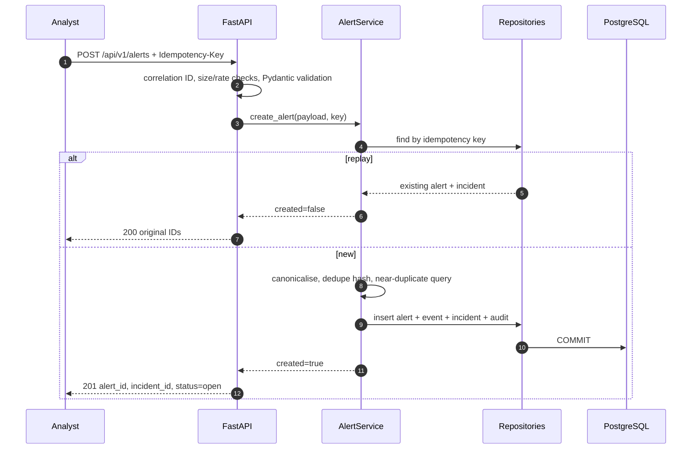
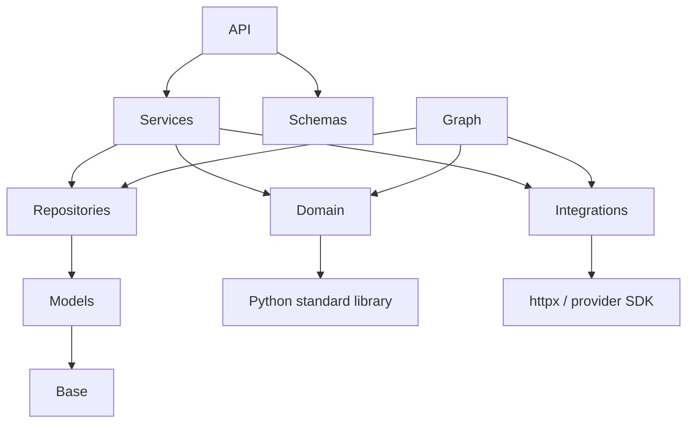

# Component Architecture

## 1. Repository layout (target)

```text
cybersentinel/
├── backend/
│   ├── cybersentinel/
│   │   ├── api/
│   │   │   ├── main.py              app factory + lifespan
│   │   │   ├── deps.py              request-scoped dependencies
│   │   │   ├── errors.py            AppError + exception handlers
│   │   │   ├── middleware/          correlation, body limit, rate limit
│   │   │   └── routers/             health, alerts, incidents,
│   │   │                            investigations, reviews
│   │   ├── schemas/                 Pydantic request/response contracts
│   │   ├── domain/                  pure security logic
│   │   ├── services/                transactional use cases
│   │   ├── graph/                   LangGraph state, build, routing, nodes
│   │   ├── integrations/            VirusTotal, Gemini, deterministic fixtures
│   │   ├── db/
│   │   │   ├── models/              SQLAlchemy 2.0 mapped classes
│   │   │   ├── repositories/        all SQL queries
│   │   │   ├── base.py              naming/metadata + portable types
│   │   │   ├── session.py           async engine/session factory
│   │   │   └── seed.py              idempotent synthetic data
│   │   ├── core/                    config, logging, security, constants
│   │   └── utils/                   IDs, time, canonical JSON, hashing
│   ├── migrations/                  Alembic environment + versions
│   ├── tests/
│   │   ├── unit/ integration/ e2e/ security/ scenarios/ evaluation/
│   │   └── conftest.py
│   ├── pyproject.toml
│   ├── requirements.txt
│   ├── alembic.ini
│   └── Dockerfile
├── frontend/                        React 18 + Vite + TS
├── deploy/                          compose.yaml, nginx.conf
├── docs/
├── scripts/
├── .env.example
├── Makefile
└── README.md
```

## 2. Component contracts

### API layer

- `create_app(settings)` constructs the app, routers, middleware and handlers.
- Dependencies provide `Settings`, `Database`, an `AsyncSession`, correlation ID and reviewer.
- No router imports a SQLAlchemy model. Routers call services with Pydantic inputs.
- Every success response carries `X-Correlation-Id`; every error repeats it in the envelope.

### Services

| Service | Use case | Transaction boundary |
| --- | --- | --- |
| `AlertService` | validate/normalise, idempotency, near-duplicate linking, alert+event+incident+audit | one transaction |
| `IncidentService` | queue/detail/evidence projections | read-only |
| `InvestigationService` | start, poll, cancel, resume; runner coordination | claim + task launch |
| `ReportService` | validate/repair/fallback/persist immutable report | one transaction |
| `ReviewService` | validate transition, persist review, set incident disposition, audit | one transaction |

### Domain modules

| Module | Inputs | Outputs | I/O |
| --- | --- | --- | --- |
| `rules.py` | normalized event + context | deterministic `Finding[]` | none |
| `risk_engine.py` | findings + enrichment + context | score, band, factors, confidence | none |
| `correlation.py` | anchor, window, candidate rows | related events, reasons, strengths | none |
| `ip_policy.py` | parsed IP | eligibility + reason code | none |
| `attack_catalog.py` | findings + related events | ≤ 5 evidence-linked candidates | none |

### Evidence protocol

Each evidence-producing node calls `EvidenceService.append()` with:

```python
{
  "kind": "rule_finding",
  "source": "rule:R-01",
  "reference": "FND-R-01",
  "captured_at": "<UTC now>",
  "value": {...canonical JSON...},
}
```

The service allocates `EV-001` monotonically **within an investigation**, computes
`sha256(canonical_json(value))`, and inserts. No update/delete path exists. Citations are
qualified as `INV-9F2A41C8:EV-001` when displayed outside an investigation.

## 3. Data flow



## 4. Dependency rules



An AST test fails on any `domain/` import of FastAPI, SQLAlchemy, httpx, Pydantic settings,
`os.environ`, or `cybersentinel.integrations`.

## 5. Cross-cutting components

| Concern | Implementation |
| --- | --- |
| Correlation ID | 26-character Crockford ULID, per request, contextvar + response header |
| Structured logs | JSON lines: timestamp, level, logger, message, correlation_id, no secrets/full IPs |
| Error envelope | `{"error": {code, message, details, correlation_id}}` |
| Body limit | ASGI middleware rejects > `MAX_REQUEST_BYTES` (default 256 KiB) with 413 |
| Rate limit | In-memory fixed-window per client, default 60/min, standard headers |
| Config | `pydantic-settings`, `.env`, startup validation, no secret defaults in live mode |
| IDs | UUIDv7 alerts, `INC-YYYY-NNNN`, `INV-XXXXXXXX`, `EV-NNN`, ULID requests |
| Time | UTC only; datetimes normalized to second precision at ingestion |
