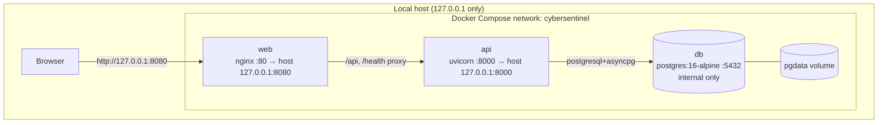
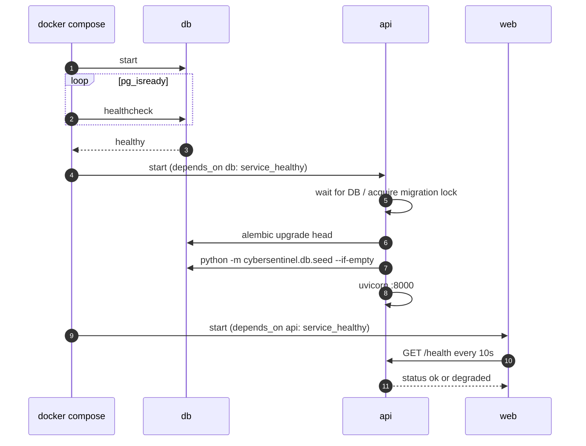

# Deployment Architecture

## 1. Compose topology

PostgreSQL has **no published port**. Every host binding uses `127.0.0.1`. There is no TLS;
this is a localhost prototype and is stated as a limitation, not hidden.

## 2. Container build

| Container | Build | Runtime | Non-root |
| --- | --- | --- | --- |
| API | `python:3.12-slim`, wheel layer, copy source | `python:3.12-slim`; `alembic upgrade head` then seed then Uvicorn | `appuser` |
| Web | `node:24-alpine`; `npm ci`; `vite build` | `nginx:1.27-alpine`; static assets + reverse proxy | nginx worker user |
| DB | official `postgres:16-alpine` | same | `postgres` |

Images never copy `.venv`, tests, caches, `.env`, Git history, or provider keys.

## 3. Startup and readiness

Migrations are never run by `Base.metadata.create_all()` in production. The seed command is
deterministic and idempotent: fixed IDs + natural-key checks prevent duplicate rows.

## 4. Configuration flow

1. Root `.env` is read by Compose and injected as environment variables.
2. `Settings` validates all values once at startup.
3. Secrets are never baked into images; `.env` is git-ignored.
4. `/health` reports non-secret configuration readiness (db, enrichment mode, LLM enabled).
5. In `ENRICHMENT_MODE=live`, missing/placeholder VirusTotal keys fail startup. In mock/off
   mode, missing keys are valid and are surfaced as such.

## 5. Volumes, retention and backup

| Volume | Contents | Retention |
| --- | --- | --- |
| `pgdata` | all relational data | prototype lifetime |
| `cache` | optional non-authoritative provider cache | TTL |
| `./data` (local non-Docker) | SQLite fallback file | prototype lifetime |

No remote backup is configured or implied. `audit_logs` and `evidence` are append-only by
ORM guard and database privileges; tamper-evidence beyond that is out of scope.

## 6. Port map

| Service | Container | Host |
| --- | --- | --- |
| web | 80 | `127.0.0.1:8080` |
| api | 8000 | `127.0.0.1:8000` |
| db | 5432 | not published |

For direct API documentation, browse `http://127.0.0.1:8000/docs`; through nginx it is
available at `http://127.0.0.1:8080/api/docs` only if explicitly proxied (M6 decision).
