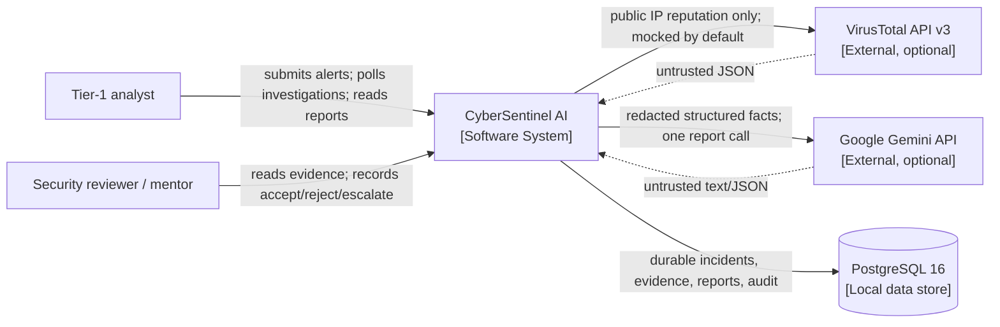
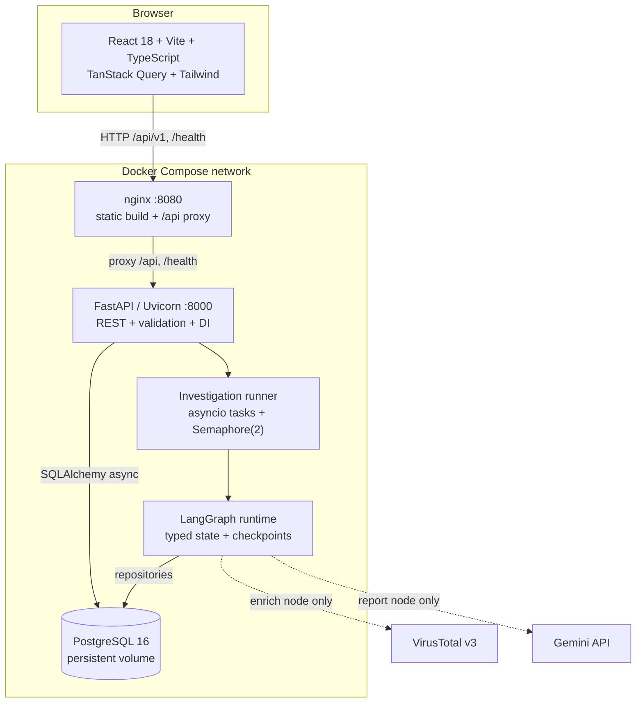
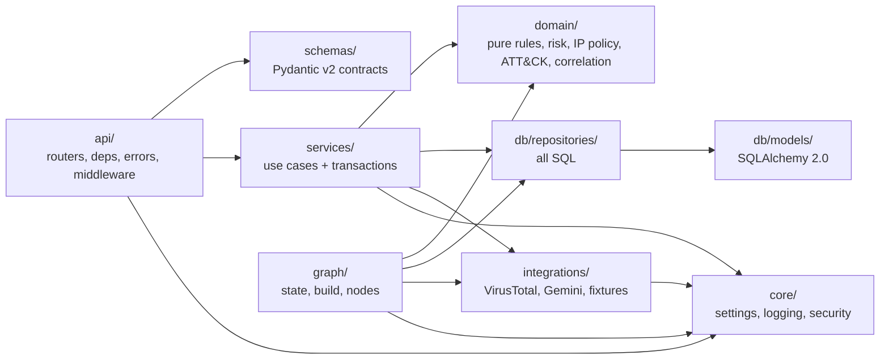

# System Architecture

## 1. Architectural position

CyberSentinel AI is a **modular monolith** with one API process, one in-process LangGraph
runtime and one PostgreSQL database. The architecture is optimised for auditability, not
scale: deterministic domain functions own every security decision, the LLM only writes prose,
and every material claim must resolve to an append-only evidence row.

Five invariants constrain every component:

1. Deterministic where it matters; generative only for narrative.
2. Evidence before claim.
3. Read-only by construction; no containment or execution tools exist.
4. Fail visibly; every dependency failure is labelled in state, API and UI.
5. One vertical slice is kept working at every milestone.

## 2. C4 Level 1 — system context

There is no SIEM, EDR, identity-provider or firewall connector in v1. That is a safety
boundary: the worst outcome of a malfunction is a wrong report, which a human reviews.

## 3. C4 Level 2 — containers

The optional adapters never sit on the deterministic path. With `LLM_ENABLED=false` and
`ENRICHMENT_MODE=off`, the graph still emits a schema-valid deterministic report.

## 4. Backend component dependencies

Forbidden edges, enforced by an AST test:

| Layer | Must not import |
| --- | --- |
| `domain/` | FastAPI, SQLAlchemy, httpx, SDKs, settings/environment |
| `api/` | SQLAlchemy models or repositories (uses services only) |
| `integrations/` | `api/`, `graph/`, `services/` |
| `schemas/` | database or network modules |
| `graph/nodes/` | FastAPI |

## 5. Runtime responsibilities

| Component | Owns | Explicitly does not own |
| --- | --- | --- |
| API | HTTP validation, error envelopes, correlation IDs, rate/body limits, DI | Business rules, SQL |
| Services | Transactions, idempotency, state transitions, audit writes | HTTP formatting |
| Domain | Triage, correlation arithmetic, risk weights, IP eligibility, ATT&CK allowlist | I/O, clocks, environment |
| Repositories | SQLAlchemy queries, persistence, row locking | Business decisions |
| Graph | Node ordering, retries, timeouts, checkpoints, degradation | External remediation |
| Integrations | Provider protocols, retries, budgets, fixtures | Scoring or attribution |
| Runner | Task registry, one run per alert, cancellation flags | Cross-process queueing |

## 6. Critical design decisions

- **Single graph, not a supervisor.** Linear pipeline + two conditional branches is
  debuggable and serialisable into `investigations.graph_state`.
- **PostgreSQL primary, SQLite test/fallback.** Compose uses PostgreSQL 16 with JSONB;
  tests use SQLite through a portable JSON/UUID type layer. See ADR-013.
- **Reports are append-only rows.** The PRD requires immutable versioned reports but does
  not list a `reports` table; the implementation adds one rather than mutating graph state.
  See ADR-012.
- **In-process runner.** `asyncio` tasks plus `Semaphore(2)`; no Redis/Celery/Kafka.
- **Idempotency at ingestion.** Header wins over body; identical replay returns the original
  alert with HTTP 200. Reusing a key for different content returns 409.
- **One reviewer identity.** `REVIEWER_NAME`, no auth/RBAC/TLS; localhost only and disclosed
  as a limitation.

## 7. Trust boundaries

| Boundary | Data | Control |
| --- | --- | --- |
| Browser → API | alert JSON, review notes | Pydantic limits, 256 KB body cap, rate limit |
| API → LLM | redacted facts, fenced raw log text | schema-constrained output, no tools, evidence allowlist |
| LLM → validator | narrative JSON | Pydantic + JSON Schema + evidence/technique allowlists |
| API → VirusTotal | eligible public IPs only | IP policy, cache, budget, timeout, mock default |
| Provider → DB | untrusted JSON | typed provider-status enum, immutable raw result |
| API → DB | parameterised SQL only | SQLAlchemy expressions, append-only tables |

## 8. Deployment units

| Unit | Image base | Port | Health |
| --- | --- | --- | --- |
| `api` | `python:3.12-slim` multi-stage | `127.0.0.1:8000` | `/health` includes DB readiness |
| `web` | `node:24-alpine` build → `nginx:1.27-alpine` | `127.0.0.1:8080` | nginx `/healthz` |
| `db` | `postgres:16-alpine` | internal only | `pg_isready` |

Startup order: `db` healthy → `api` runs `alembic upgrade head` → idempotent seed → Uvicorn;
`web` depends on API health. Persistent named volume `pgdata` holds database state.

## 9. Failure posture

| Failure | System response |
| --- | --- |
| Database unreachable | `/health` 503/degraded; mutating request 503 envelope |
| VirusTotal timeout/budget | `completed_degraded`; gap + `provider_status`; no score inflation |
| Gemini outage/invalid JSON | deterministic template report, `degraded=true` |
| Node exception | retry budget, then typed error + safe empty value or `degrade` |
| Process crash mid-run | checkpoint remains; startup marks `interrupted`, never pretends success |
| Oversized/invalid input | 413/422 envelope with field details and correlation ID |
