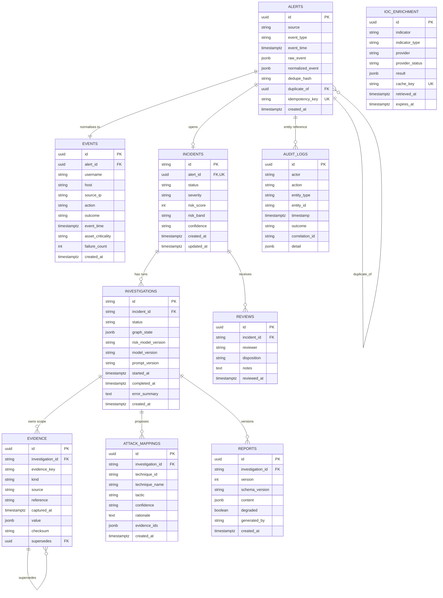

# Database ERD and Data Rules

## 1. Entity–relationship diagram

## 2. Table ownership and constraints

| Table | Critical constraints / indexes | Mutability |
| --- | --- | --- |
| `alerts` | UUIDv7 PK; `idempotency_key` unique where not null; `dedupe_hash` index; self-FK `duplicate_of`; `(event_time)` index | insert-only (duplicate link set once) |
| `events` | FK `alert_id` unique; indexes `(username, event_time)`, `(source_ip, event_time)`, `(host, event_time)` | insert-only |
| `incidents` | `alert_id` unique; status enum; `(status, risk_score desc, created_at desc)` queue index | status/score update only |
| `investigations` | status enum; `(incident_id, created_at)`; one active run enforced by runner + partial unique index | status/timestamps/state update |
| `evidence` | unique `(investigation_id, evidence_key)`; `(investigation_id, captured_at)`; checksum 64 hex chars; append-only | insert-only |
| `ioc_enrichment` | unique `cache_key`; `expires_at` index; provider status enum | cache upsert permitted |
| `attack_mappings` | allowlist enforced in domain; unique `(investigation_id, technique_id)`; evidence_ids non-empty | insert-only |
| `reports` | unique `(investigation_id, version)`; report JSON schema version | insert-only |
| `reviews` | disposition enum; notes required for reject/escalate (service + CHECK); `(incident_id, reviewed_at)` | insert-only |
| `audit_logs` | append-only; `(timestamp)`, `(entity_type, entity_id)`, `(correlation_id)` | insert-only |

## 3. Identifier strategy

| Entity | Format | Generation |
| --- | --- | --- |
| Alert | UUIDv7 | RFC 9562 layout, time-ordered, generated in application |
| Incident | `INC-YYYY-NNNN` | yearly counter, unique constraint + bounded retry on collision |
| Investigation | `INV-XXXXXXXX` | 32 random bits, uppercase hex, retry on collision |
| Evidence | `EV-NNN` | max existing key + 1 inside investigation transaction |
| Report | UUID | server generated, `(investigation_id, version)` monotonic |
| Request | ULID (26 chars) | correlation middleware |

`EV-` identifiers are scope-local. The UI and cross-investigation exports use the qualified
form `INV-9F2A41C8:EV-001`.

## 4. Evidence invariants

1. Insert-only. ORM `before_update`/`before_delete` listeners raise for evidence and audit rows.
2. `checksum = sha256(canonical_json(value))`, where canonical JSON uses UTF-8, sorted keys,
   compact separators and normalized UTC timestamps.
3. Any correction inserts a new row with `supersedes` set; the old row is never modified.
4. The report validator resolves every cited evidence ID and recomputes the checksum.
5. A report may cite only evidence from its own investigation.

## 5. JSON and dialect strategy

PostgreSQL is the deployment database and uses native `JSONB`. SQLite is supported for tests
and the documented Day-1 fallback using the generic `JSON` type. The `base.py` type layer uses
`JSONB().with_variant(JSON, "sqlite")`, so no application or repository branch depends on the
dialect. UUIDs are stored through SQLAlchemy's portable `Uuid` type; timestamps are UTC.

## 6. Retention and privacy

- No automatic pruning in v1; the prototype retains all data.
- `audit_logs` are never updated or deleted.
- Synthetic data only: documentation ranges, `example.com`, RFC 1918 space.
- Logs redact public IPs to /24 and never contain API keys, tokens or full request bodies.
- No remote backup or telemetry exists.

## 7. Migration policy

Every schema change requires a new Alembic revision. `alembic upgrade head` must work on an
empty database. `Base.metadata.create_all()` is permitted only in isolated test fixtures and
is explicitly not the production migration path.
