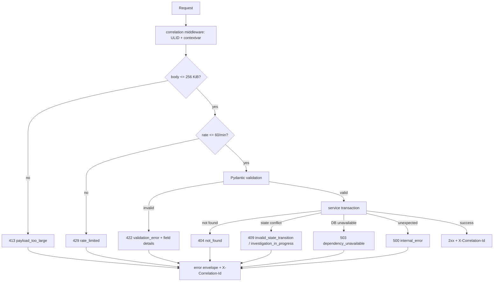
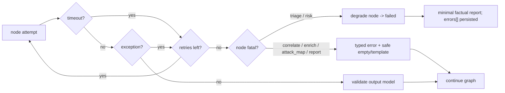

# Error and Failure Flow

## 1. One envelope everywhere

```json
{
  "error": {
    "code": "validation_error",
    "message": "Alert failed validation",
    "details": [
      {"field": "event_time", "issue": "timezone offset required"}
    ],
    "correlation_id": "01JBQ8Z3K4M2N7P9R1S6T8V0WX"
  }
}
```

No stack trace, SQL fragment, provider payload, secret or internal path appears in a response.
The correlation ID maps to structured server logs and the relevant audit row.

## 2. Request lifecycle



## 3. Exception mapping

| Exception | Status | Code |
| --- | --- | --- |
| `AppError` | declared | declared |
| `RequestValidationError` | 422 | `validation_error` (or `unsupported_event_type`) |
| body-size middleware | 413 | `payload_too_large` |
| rate middleware | 429 | `rate_limited` |
| malformed JSON/content type | 400 | `malformed_request` |
| `IntegrityError` | 409 or 500 | `conflict` / `internal_error` |
| `OperationalError` / DB connect | 503 | `dependency_unavailable` |
| unhandled `Exception` | 500 | `internal_error` |

## 4. Graph failure flow



Append-only `errors[]` and `trace[]` survive retries. Provider failures never abort an
investigation; only database persistence failure or fatal triage/risk failure produces a
terminal `failed` status.

## 5. Client-visible failure states

| State | UI treatment |
| --- | --- |
| API unreachable | persistent banner + retry; no stale success |
| 422 | inline field errors from `details[]` |
| 409 review conflict | explicit conflict message, form retains input |
| degraded investigation | amber banner naming failed dependency |
| failed investigation | red panel; report marked unavailable/factual-only |
| mock enrichment | `MOCK` text badge, never colour-only |
| skipped enrichment | reason code shown adjacent to indicator |

## 6. Logging and audit

- Every request log line carries `correlation_id`, method, path, status, duration.
- Authentication keys/tokens are redacted by a logging filter; public IPs are truncated to /24.
- Mutating actions write `audit_logs` with actor, action, entity, outcome and correlation ID.
- Audit and evidence tables are append-only; failed writes roll back the whole transaction.
- `/health` failures log dependency name and latency, never credentials or DSNs.
