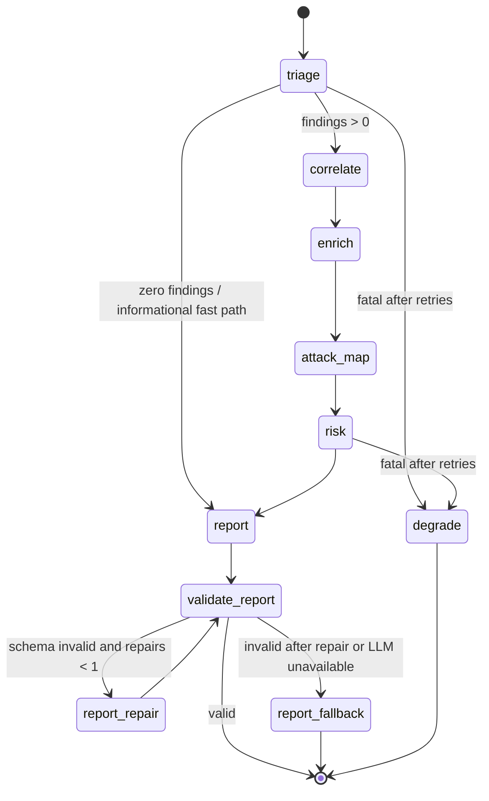
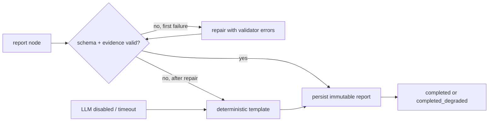

# Investigation Execution Flow

## 1. End-to-end sequence

```mermaid
sequenceDiagram
    autonumber
    participant U as Analyst
    participant API as FastAPI
    participant IS as InvestigationService
    participant RUN as asyncio runner
    participant G as LangGraph
    participant DB as PostgreSQL
    participant VT as VirusTotal (optional)
    participant LLM as Gemini (optional)

    U->>API: POST /api/v1/alerts/{id}/investigate
    API->>IS: start(alert_id)
    IS->>DB: load alert/incident; check active run
    alt active run exists
        IS-->>API: conflict
        API-->>U: 409 investigation_in_progress
    else eligible
        IS->>DB: insert investigation (queued)
        IS->>RUN: create task; semaphore(2)
        IS-->>API: investigation_id
        API-->>U: 202 + poll URL
    end
    RUN->>DB: status=running
    RUN->>G: ainvoke(state, thread_id=investigation_id)
    G->>G: triage -> correlate -> enrich -> attack_map -> risk -> report
    opt eligible public IP and mode != off
        G->>VT: GET /ip_addresses/{ip}
        VT-->>G: JSON / timeout / 429
    end
    opt LLM enabled
        G->>LLM: schema-constrained report request
        LLM-->>G: JSON
    end
    G->>G: validate -> repair (<=1) -> fallback
    G-->>RUN: terminal state + report
    RUN->>DB: persist evidence/mappings/report; status terminal
    loop every 1s while running
        U->>API: GET /api/v1/investigations/{id}
        API-->>U: status + completed nodes + trace
    end
    U->>API: GET /api/v1/incidents/{id}
    API-->>U: report + evidence + review state
```

`POST /investigate` never waits for the graph. The UI polls because the graph contains network
calls and an LLM call; a synchronous endpoint would be timeout-prone and would hide progress.

## 2. LangGraph topology



`correlate`, `enrich`, `attack_map` and `report` are recoverable: they emit a typed error and a
safe empty/template value, then continue. `triage` and `risk` are fatal because every
downstream claim depends on their output.

## 3. Typed state

```text
InvestigationState
├── identity: investigation_id, incident_id, alert_id, window
├── input: event
├── triage: findings
├── correlation: related_events
├── enrichment: enrichment[], skipped_indicators[]
├── mapping: attack_candidates[]
├── risk: risk
├── evidence: evidence[]  (append-only view)
├── output: report | null, degraded
└── bookkeeping: errors[] (operator.add), trace[] (operator.add), llm_meta
```

Rules: every node validates its output model; `errors` and `trace` append; the persisted
`graph_state` is redacted; `thread_id == investigation_id`; one checkpoint per transition.

## 4. Node contracts

| Node | Timeout | Retries | Failure mode | Evidence produced |
| --- | --- | --- | --- | --- |
| `triage` | 2 s | 0 | fatal → `degrade` | alert field + rule finding rows |
| `correlate` | 3 s | 1 | recoverable empty list + gap | correlated event rows |
| `enrich` | 8 s total | 2 (0.5 s, 1 s) | provider status, gap; continue | enrichment/skip rows |
| `attack_map` | 2 s | 0 | empty candidates + gap | mapping evidence rows |
| `risk` | 1 s | 0 | fatal → degraded score | derived score evidence |
| `report` | 20 s | 1 | deterministic template | no new external evidence |
| `validate_report` | 1 s | 0 | route repair/fallback | none |
| `degrade` | 1 s | 0 | terminal, always emits output | minimal factual report |

No node except `enrich` and `report` performs external I/O. No node has a tool that can mutate
an external system.

## 5. Risk pipeline (`risk-v1`)

```text
R-01 failure burst        8 (5–9) / 14 (10–19) / 20 (>=20)
R-02 success after burst  10 (3–4 prior) / 20 (>=5 prior within 30m)
R-03 privilege/asset      8 privileged / 8 critical / 15 both
R-04 privilege change     20 explicit role grant / 12 ambiguous group change
R-05 external reputation  15 malicious >=5 engines / 8 suspicious 1–4
R-06 unusual context      10 first-seen public IP with >=5 prior events
raw = sum(fired rule points); score = min(raw, 100)
bands: 0–24 informational | 25–49 low | 50–74 medium | 75–100 high
```

Absence contributes zero and appears in `missing_signals`; clean enrichment never subtracts.
Confidence is independent: high (no gaps), medium (one gap), low (two gaps or enrichment
unavailable and no correlation).

## 6. Report recovery



The LLM receives immutable, already-computed facts. It cannot add evidence IDs, technique IDs
or recommended actions with `destructive=true`. Unknown citations, unknown technique IDs,
severity/band mismatch and missing approval flags reject the report.

## 7. Checkpointing, concurrency and recovery

- `SqliteSaver` for local development, `PostgresSaver` in Compose; `thread_id` is the
  investigation ID.
- The runner keeps `{alert_id: Task}`, refuses a second active run with 409, and limits
  concurrent graph executions with `Semaphore(2)`.
- Cancellation is cooperative: a flag is checked between nodes; terminal status `cancelled`
  with a partial report.
- On startup, any `running` row becomes `interrupted`. The operator may resume from the last
  checkpoint; the system never reports it as complete.
- A duplicate `POST /investigate` while a run is active returns 409; after terminal failure a
  new run may be created.

## 8. Degradation matrix

| Failure | Status | Report | Visible signal |
| --- | --- | --- | --- |
| VT timeout | `completed_degraded` | valid, gap | `provider_status=timeout` |
| VT 429/quota | `completed_degraded` | valid, gap | `provider_status=rate_limited` |
| IP ineligible | `completed` | valid, no claim | `not_eligible:<reason>` |
| LLM unavailable | `completed_degraded` | template | `degraded=true` |
| LLM invalid twice | `completed_degraded` | template + validator error | `degradation_notes` |
| correlation query fails | `completed_degraded` | valid + gap | `errors[]` |
| triage raises | `failed` | minimal factual report | `errors[]` |
| DB write fails | `failed` | none persisted | HTTP 5xx + correlation ID |
