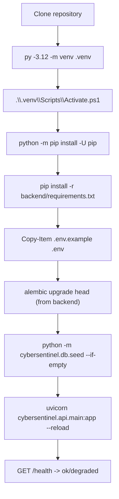
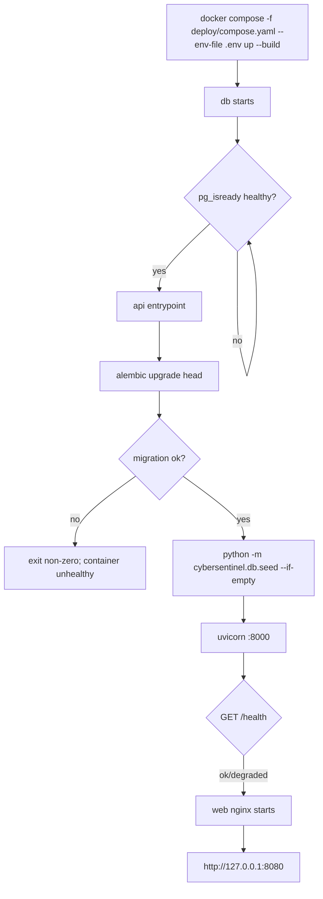

# Startup Flow

## 1. Local (PowerShell, Python 3.12)



Local default is SQLite (`sqlite+aiosqlite:///./data/cybersentinel.db`) so M1 never depends on
Docker. Set `DATABASE_URL` to PostgreSQL for parity. Tests use an isolated SQLite database.

## 2. Docker Compose



The API waits for database health; `web` waits for API health. Migrations and seed run before
serving. Failures are visible in container status and logs, never swallowed.

## 3. Application lifespan

1. Construct `Settings` from environment and validate.
2. Configure structured JSON logging (level, service name).
3. Create the async engine and session factory; no implicit schema creation.
4. Mark stale `running` investigations as `interrupted` (M3+).
5. Expose the app.
6. On shutdown: cancel runner tasks cooperatively, dispose the engine.

`GET /health` independently checks database connectivity and reports:

```json
{
  "status": "ok",
  "version": "0.1.0",
  "checks": {
    "database": {"status": "ok", "latency_ms": 2},
    "enrichment": {"mode": "mock", "configured": true},
    "llm": {"enabled": false, "configured": false}
  }
}
```

`status` is `degraded` if a non-critical dependency is unconfigured or unavailable; database
failure is reflected as `degraded` with HTTP 503 at the readiness endpoint (liveness remains
available for orchestration).

## 4. Configuration validation

| Condition | Result |
| --- | --- |
| invalid enum/range | startup fails with a clear Pydantic error |
| `ENRICHMENT_MODE=live` and no VT key | startup fails (no silent live→mock downgrade) |
| `LLM_ENABLED=true` and no Gemini key | startup fails |
| mock/off enrichment | starts without external keys |
| weak/default key present | startup refuses in live mode |
| SQLite path parent missing | created for local convenience, then Alembic runs |

Secrets are never echoed by `/health`, logs, reports or error envelopes.
